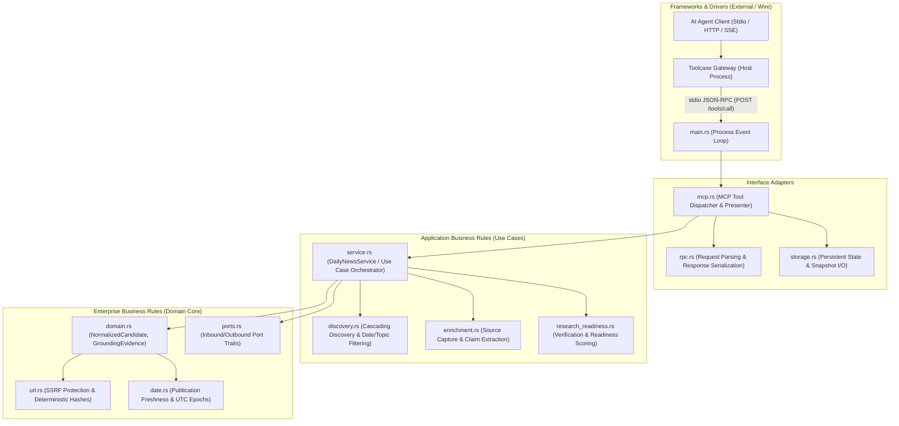

# Toolcase Gateway Modules — Native Model Context Protocol (MCP) Feature Design

This document establishes the official architectural specification, Clean Architecture layer separation, and implementation blueprint for native **Model Context Protocol (MCP)** tool and resource support across Toolcase Gateway modules, featuring the primary implementation reference for [`modules/daily-news`](file:///home/ubuntu/gateway-modules/modules/daily-news).

---

## 1. Executive Summary & Context

**Toolcase Gateway** serves as a high-performance, modular AI agent proxy and tool runtime. Through native MCP integration, any platform module can expose its domain capabilities, discovery feeds, research packages, and verification pipelines directly to AI agents (such as Antigravity, Claude Desktop, Cursor, or autonomous agent loops) via standard MCP interfaces:

- **Universal Multi-Transport**: Agents communicate with the gateway via stdio (`--mcp`), Streamable HTTP (`POST /mcp`), or Server-Sent Events (`GET /mcp/sse`).
- **Extensible Module Aggregation**: Modules declare domain tools via `module.json`'s `tools` array; the gateway dynamically namespaces (`<module_id>__<tool_name>`) and mounts them into `tools/list`.
- **Zero-Async Synchronous Execution**: Modules run as isolated, out-of-process native Rust binaries communicating over standard Unix stdio streams, strictly bounded to a 30-second execution timeout.
- **Clean Architecture Decoupling**: High-level domain business logic and entities remain 100% pure and decoupled from MCP wire schemas and JSON-RPC framing.

---

## 2. Clean Architecture & Domain-Driven Design (DDD)

Adhering strictly to Clean Architecture (Inward Dependency Rule) and DDD, MCP tool handling is divided into distinct concentric layers:



### 2.1. Layer Responsibilities

1. **Domain Core Layer (`domain.rs`, `ports.rs`)**:
   - Pure domain entities (`NormalizedCandidate`, `ClaimEvidence`, `VisualEvidence`, `ResearchReadiness`).
   - Domain port traits (`FeedProvider`, `StoragePort`, `DiscussionPort`, `SourceCapturePort`).
   - Zero awareness of MCP, HTTP headers, JSON-RPC envelopes, or stdio framing.
2. **Application / Use Cases Layer (`service.rs`, `enrichment.rs`, `research_readiness.rs`)**:
   - Executes domain business operations:
     - `discover(topics, date_range, limit, curated)`
     - `get_candidate(candidate_id)`
     - `enrich_candidate(candidate_id, override_url, claims, visuals)`
     - `evaluate_readiness_with_snapshot_store(...)`
     - `get_evidence_snapshot(sha256)`
   - Pure business logic, independent of whether the caller is a REST client, HTML UI, or an AI Agent calling an MCP tool.
3. **Interface Adapter Layer (`mcp.rs`, `rpc.rs`)**:
   - **Inbound MCP Adapter**: Deserializes incoming `POST /tools/call` JSON payloads:
     ```json
     {
       "name": "discover_candidates",
       "tool": "discover_candidates",
       "arguments": { "topics": ["rust", "ai"], "limit": 5 }
     }
     ```
   - **Validation & Sanitization**: Validates parameters at the system boundary (fail-closed on unknown fields, malformed IDs, or path traversal).
   - **Outbound Presenter**: Maps domain entity results into standard MCP Content format:
     ```json
     {
       "content": [
         {
           "type": "text",
           "text": "{\"count\": 1, \"items\": [...]}"
         }
       ]
     }
     ```
4. **Frameworks & Drivers Layer (`main.rs`, `run.sh`)**:
   - Stdio event loop reading one JSON request per line from stdin and flushing formatted JSON responses to stdout.
   - Bounded execution with immediate fail-closed error propagation.

---

## 3. Declarative Manifest Specification (`module.json`)

Modules declare their explicit MCP toolset in `module.json` via the `tools` array using standard JSON Schema. When registered in Toolcase Gateway, these tools are automatically namespaced with the prefix `daily-news__`.

```json
{
  "id": "daily-news",
  "name": "Daily News & Content Discovery Service",
  "short_name": "Daily News",
  "version": "1.10.1",
  "namespace": "/custom/daily-news",
  "entrypoint": "run.sh",
  "protocol": "stdio-stream",
  "capabilities": [
    "news",
    "content_discovery",
    "chat_completions",
    "models",
    "redis",
    "reddit",
    "discussion",
    "source_capture",
    "research_readiness",
    "enrichment"
  ],
  "tools": [
    {
      "name": "discover_candidates",
      "description": "Discover and score fresh tech and AI news candidates filtered by topic, date window, and quality thresholds.",
      "inputSchema": {
        "type": "object",
        "properties": {
          "topics": {
            "type": "array",
            "items": { "type": "string" },
            "description": "Optional list of topics (e.g. ['rust', 'llm', 'security'])"
          },
          "from_date": {
            "type": "string",
            "description": "ISO 8601 start date timestamp (e.g. '2026-11-01T00:00:00Z')"
          },
          "to_date": {
            "type": "string",
            "description": "ISO 8601 end date timestamp (e.g. '2026-11-04T00:00:00Z')"
          },
          "sources": {
            "type": "array",
            "items": { "type": "string" },
            "description": "Optional feed sources (e.g. ['hackernews', 'reddit'])"
          },
          "limit": {
            "type": "integer",
            "minimum": 1,
            "maximum": 50,
            "default": 10,
            "description": "Maximum number of candidate articles to return"
          }
        }
      }
    },
    {
      "name": "get_candidate",
      "description": "Retrieve full candidate details, research evidence fields, and publication metadata by candidate ID.",
      "inputSchema": {
        "type": "object",
        "properties": {
          "candidate_id": {
            "type": "string",
            "description": "Unique canonical candidate identifier (e.g. 'cand_0123456789abcdef')"
          }
        },
        "required": ["candidate_id"]
      }
    },
    {
      "name": "enrich_candidate",
      "description": "Enrich a candidate article with captured primary source snapshot, structured claims, and visual evidence.",
      "inputSchema": {
        "type": "object",
        "properties": {
          "candidate_id": {
            "type": "string",
            "description": "Candidate ID to enrich"
          },
          "override_url": {
            "type": "string",
            "description": "Optional explicit primary source URL if different from discovery canonical URL"
          },
          "claims": {
            "type": "array",
            "description": "List of grounded factual claims extracted from the article",
            "items": {
              "type": "object",
              "properties": {
                "claim_id": { "type": "string" },
                "statement": { "type": "string" },
                "verification_status": {
                  "type": "string",
                  "enum": ["UNVERIFIED", "SOURCE_SUPPORTED", "INDEPENDENTLY_VERIFIED"]
                },
                "evidence_refs": {
                  "type": "array",
                  "items": {
                    "type": "object",
                    "properties": {
                      "source_ref": { "type": "string", "description": "SHA-256 hash of source snapshot" },
                      "excerpt": { "type": "string", "description": "Verbatim quote from snapshot text" },
                      "locator": { "type": "string", "description": "Section or paragraph locator" }
                    },
                    "required": ["source_ref", "excerpt", "locator"]
                  }
                }
              },
              "required": ["claim_id", "statement", "verification_status", "evidence_refs"]
            }
          },
          "visual_evidence": {
            "type": "array",
            "description": "List of validated visual assets (charts, diagrams, code blocks)",
            "items": {
              "type": "object",
              "properties": {
                "asset_id": { "type": "string" },
                "kind": { "type": "string" },
                "url": { "type": "string" },
                "checksum_sha256": { "type": "string" },
                "license": { "type": "string" },
                "verified_rights": { "type": "boolean" },
                "license_evidence_ref": { "type": "string" }
              },
              "required": ["asset_id", "kind", "url", "checksum_sha256", "license", "verified_rights", "license_evidence_ref"]
            }
          }
        },
        "required": ["candidate_id"]
      }
    },
    {
      "name": "verify_research_readiness",
      "description": "Score video production readiness (VIDEO_READY, NEEDS_RESEARCH, NEEDS_VERIFICATION, NEEDS_VISUAL_EVIDENCE) with strict evidence grounding.",
      "inputSchema": {
        "type": "object",
        "properties": {
          "candidate_id": {
            "type": "string",
            "description": "Candidate ID to evaluate for video production readiness"
          }
        },
        "required": ["candidate_id"]
      }
    },
    {
      "name": "get_evidence_snapshot",
      "description": "Fetch the immutable, SHA-256 content-addressed text snapshot of a captured primary or secondary source.",
      "inputSchema": {
        "type": "object",
        "properties": {
          "sha256": {
            "type": "string",
            "pattern": "^[a-fA-F0-9]{64}$",
            "description": "64-character hex SHA-256 hash of the snapshot artifact"
          }
        },
        "required": ["sha256"]
      }
    },
    {
      "name": "get_discussion",
      "description": "Retrieve community reactions, commentary trees, and sentiment for a news story (explicitly marked as community opinion, not factual support).",
      "inputSchema": {
        "type": "object",
        "properties": {
          "url_or_id": {
            "type": "string",
            "description": "Discussion URL or post ID (e.g. Hacker News story ID or Reddit permalink)"
          },
          "limit": {
            "type": "integer",
            "minimum": 1,
            "maximum": 100,
            "default": 20,
            "description": "Maximum number of comments to retrieve"
          }
        },
        "required": ["url_or_id"]
      }
    }
  ]
}
```

---

## 4. Gateway Wire Protocol & Stdio Execution

### 4.1. Request Flow

When an agent invokes tool `daily-news__discover_candidates`, the Toolcase Gateway executes the personal module over `stdio-stream`:

```text
Host Process (toolcase-gateway)                     Module Process (daily-news)
       │                                                          │
       │  POST /tools/call                                        │
       │  Header: x-mcp-tool: discover_candidates                 │
       │  Body: {"name":"discover_candidates",                    │
       │         "arguments":{"topics":["rust"]}}                 │
       ├─────────────────────────────────────────────────────────▶│
       │                                                          │ (Parse, Validate,
       │                                                          │  Execute Use Case)
       │  HTTP 200 OK                                             │
       │  {"content":[{"type":"text","text":"{...}"}]}            │
       │◀─────────────────────────────────────────────────────────┤
       │                                                          │
```

### 4.2. Stdio Request Framing

Toolcase Gateway transmits the request formatted as a single JSON line to the child process's standard input:

```json
{
  "method": "POST",
  "path": "/tools/call",
  "headers": [
    ["content-type", "application/json"],
    ["x-mcp-tool", "discover_candidates"]
  ],
  "body": "{\"name\":\"discover_candidates\",\"arguments\":{\"topics\":[\"rust\"],\"limit\":5}}"
}
```

### 4.3. Standard Tool Response Framing

The module responds on standard output with a single line JSON response:

```json
{
  "status": 200,
  "headers": [
    ["content-type", "application/json"]
  ],
  "body": "{\"content\":[{\"type\":\"text\",\"text\":\"{\\\"count\\\":1,\\\"items\\\":[...]\\\"}\"}]}"
}
```

### 4.4. Error Handling & Fail-Closed Semantics

When validation fails or an unknown tool is invoked, the module returns an MCP-compliant error response within a 200/400 envelope:

```json
{
  "status": 400,
  "headers": [
    ["content-type", "application/json"]
  ],
  "body": "{\"content\":[{\"type\":\"text\",\"text\":\"Error: Unknown or unsupported tool 'invalid_tool'\"}],\"isError\":true}"
}
```

---

## 5. Security & Boundary Safeguards

1. **SSRF Mitigation (`url.rs`)**:
   - Any external URL provided in tool arguments (`override_url`, `url`) is verified via `is_safe_url()`.
   - Blocks private IP spaces (`10.0.0.0/8`, `172.16.0.0/12`, `192.168.0.0/16`, `169.254.0.0/16`), loopback addresses (`127.0.0.0/8`, `::1`), and non-HTTP/HTTPS schemes.
2. **Path Traversal Protection (`storage.rs`)**:
   - Snapshots requested via `get_evidence_snapshot` must strictly match a 64-character alphanumeric hex pattern.
   - Files are resolved exclusively within `.state/evidence/{sha256}.txt`; relative directory traversal (`../`) is strictly rejected.
3. **Bounded Timeout & CPU Safety**:
   - Out-of-process execution is bounded to 30 seconds by the gateway host.
   - Processing is synchronous and memory-bounded without background thread leaks.

---

## 6. Implementation Blueprint

### 6.1. File Layout
```text
modules/daily-news/
├── module.json                  # Manifest with explicit tools array
├── src/
│   ├── mcp.rs                   # Clean Architecture MCP tool adapter (under 250 lines)
│   ├── main.rs                  # Wire router dispatching "/tools/call" -> mcp.rs
│   ├── service.rs               # Pure application orchestrator
│   ├── domain.rs                # Pure domain entities
│   └── ports.rs                 # Inbound & outbound traits
└── tests/
    └── test_mcp_tools.rs        # Automated MCP end-to-end integration tests
```

### 6.2. Sizing Compliance
- `src/mcp.rs`: ~220 lines (well under the 450-line target).
- `src/main.rs`: Adds a 15-line route arm (`"/tools/call" => handle_mcp_tool(...)`), keeping `main.rs` comfortably within ceilings.
- Preserves 100% backward compatibility for all existing HTTP endpoints.
