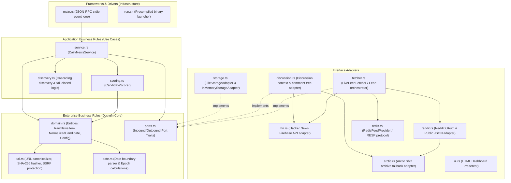

# Daily News Module — Architecture & Technical Design

This document details the internal design, Clean Architecture layers, concurrency invariants, and data flow of the `daily-news` native Rust module.

---

## 1. Clean Architecture & DDD Layer Separation

The module follows strict Clean Architecture and Domain-Driven Design (DDD) principles:



### Inward Dependency Rule
- High-level business logic in `service.rs`, `scoring.rs`, `discovery.rs`, and `domain.rs` has **zero dependencies** on external frameworks, database drivers, or wire transports.
- Outbound interfaces are strictly governed by traits defined in `ports.rs`:
  - `FeedFetcherPort`: Outbound port for fetching raw news items from external feeds.
  - `DiscussionFetcherPort`: Outbound port for on-demand discussion thread & comment tree inspection.
  - `StoragePort`: Outbound port for tracking consumed candidate IDs, candidate caching, and configuration persistence.

---

## 2. File Layout & Sizing Governance

Every Rust source file adheres to strict modular sizing rules (target: **under 450 lines**, hard limit: **800 lines**):

| Source File | Line Count | Clean Architecture Role | Responsibilities |
| :--- | :--- | :--- | :--- |
| [`src/domain.rs`](file:///home/ubuntu/gateway-modules/modules/daily-news/src/domain.rs) | 333 | Domain Entities & Models | `RawNewsItem`, `NormalizedCandidate`, `StoryboardEvidence`, `ModuleConfig`. |
| [`src/url.rs`](file:///home/ubuntu/gateway-modules/modules/daily-news/src/url.rs) | 286 | Domain Logic & Security | URL canonicalization, tracking parameter stripping, SHA-256 hashing, SSRF boundaries. |
| [`src/date.rs`](file:///home/ubuntu/gateway-modules/modules/daily-news/src/date.rs) | 160 | Domain Value Object & Math | ISO 8601 string parsing, midnight boundary calculations, epoch arithmetic. |
| [`src/ports.rs`](file:///home/ubuntu/gateway-modules/modules/daily-news/src/ports.rs) | 50 | Domain Ports (Traits) | `FeedFetcherPort`, `DiscussionFetcherPort`, `StoragePort`. |
| [`src/discovery.rs`](file:///home/ubuntu/gateway-modules/modules/daily-news/src/discovery.rs) | 91 | Application Logic | Cascade bounds validation, topic matching, fail-closed result construction. |
| [`src/scoring.rs`](file:///home/ubuntu/gateway-modules/modules/daily-news/src/scoring.rs) | 321 | Domain Service | Deterministic 6-axis scoring engine, authority weighting, decay curves. |
| [`src/service.rs`](file:///home/ubuntu/gateway-modules/modules/daily-news/src/service.rs) | 398 | Application Service | Tiered cascade discovery use case, candidate normalization, topic filtering. |
| [`src/storage.rs`](file:///home/ubuntu/gateway-modules/modules/daily-news/src/storage.rs) | 198 | Secondary Adapter (Storage) | `InMemoryStorageAdapter`, `FileStorageAdapter` (persistent JSON state in `.state/`). |
| [`src/fetcher.rs`](file:///home/ubuntu/gateway-modules/modules/daily-news/src/fetcher.rs) | 374 | Secondary Adapter (Feeds) | Multi-source feed orchestrator linking HN, Reddit, Redis, and NewsNow. |
| [`src/hn.rs`](file:///home/ubuntu/gateway-modules/modules/daily-news/src/hn.rs) | 308 | Secondary Adapter (Hacker News) | Live Hacker News Firebase API client and comment enrichment. |
| [`src/reddit.rs`](file:///home/ubuntu/gateway-modules/modules/daily-news/src/reddit.rs) | 423 | Secondary Adapter (Reddit) | Reddit OAuth client-credentials, public JSON feed ingestion, and fallback. |
| [`src/arctic.rs`](file:///home/ubuntu/gateway-modules/modules/daily-news/src/arctic.rs) | 248 | Secondary Adapter (Arctic Shift) | Zero-key Reddit search and archive API fallback for datacenter environments. |
| [`src/discussion.rs`](file:///home/ubuntu/gateway-modules/modules/daily-news/src/discussion.rs) | 417 | Secondary Adapter (Discussion) | On-demand discussion thread & comment tree inspector across Reddit and HN. |
| [`src/redis.rs`](file:///home/ubuntu/gateway-modules/modules/daily-news/src/redis.rs) | 332 | Secondary Adapter (Redis) | Native RESP parser, Redis Streams (`XREVRANGE`), Redis Lists (`LRANGE`). |
| [`src/ui.rs`](file:///home/ubuntu/gateway-modules/modules/daily-news/src/ui.rs) | 157 | Primary Adapter (Presenter) | Standalone dark-mode HTML status dashboard. |
| [`src/main.rs`](file:///home/ubuntu/gateway-modules/modules/daily-news/src/main.rs) | 416 | Frameworks & Drivers | Unix stdio-stream JSON-RPC event loop and request dispatcher. |

---

## 3. Storage Architecture: Decorator Pattern

Persistence in `daily-news` is structured using the **Decorator Pattern**:
1. **`InMemoryStorageAdapter`**: A lightweight, pure in-memory struct protected by `std::sync::RwLock`. Manages consumed candidate IDs in a `HashSet<String>`, dynamic configuration in `ModuleConfig`, and cached candidate lists.
2. **`FileStorageAdapter`**: Decorates `InMemoryStorageAdapter`. It loads initial state from disk (`config.json` and `.state/consumed.json`) on startup, delegates operations to `InMemoryStorageAdapter`, and synchronously flushes mutations to JSON files.

```rust
pub struct FileStorageAdapter {
    config_path: PathBuf,
    state_dir: PathBuf,
    inner: InMemoryStorageAdapter,
}
```

This guarantees 0% code duplication between unit tests (which run purely in-memory) and production operation (which runs with disk persistence).

---

## 4. Zero-Async Concurrency Invariants

In compliance with Toolcase Gateway's zero-async architectural requirement:
- **No Async Runtime**: Neither `tokio`, `async-std`, nor `futures` is linked.
- **Synchronous Networking**: HTTP requests are executed via `ureq` and native sockets via `std::net::TcpStream` with strict connect and read timeouts (3 seconds).
- **Process Isolation**: The module runs as an independent OS process interacting with Toolcase Gateway via standard stdio pipes. The gateway host never blocks on long-running network operations within the module.

---

## 5. Security Architecture & SSRF Protection

External source URLs are validated at domain boundaries using `is_safe_url`:
- **Protocol Enforcement**: Accepts only `http://` or `https://` schemes.
- **SSRF Filter**: Parses the hostname as an IPv4 address and strictly drops private IP ranges:
  - `10.0.0.0/8` (Private network)
  - `172.16.0.0/12` (Private network)
  - `192.168.0.0/16` (Private network)
  - `169.254.0.0/16` (Link-local cloud metadata)
  - `0.0.0.0/8` (Broadcast)
  - Localhost (`127.0.0.1`) is permitted strictly for loopback service discovery (e.g. local Redis or NewsNow).
- **Tracking Parameter Sanitization**: All incoming URLs are canonicalized to strip tracking and fingerprinting parameters (`utm_source`, `utm_medium`, `utm_campaign`, `utm_term`, `utm_content`, `fbclid`, `gclid`, `msclkid`, `ref`, `source`, `rss`).
