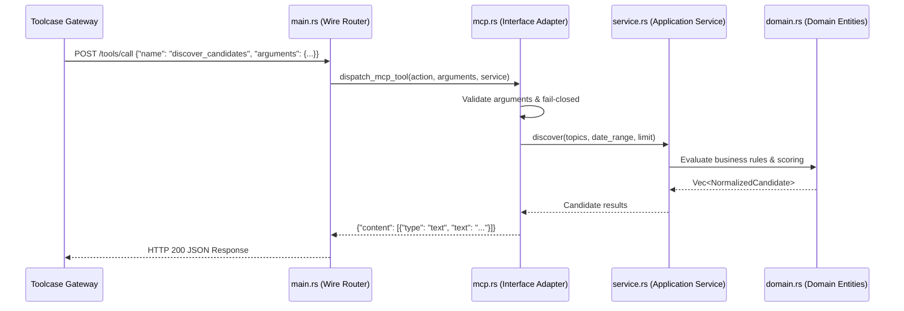

# Daily News Module — MCP Feature Design & Integration

> **Note**: For the comprehensive, repository-wide MCP architecture specification, see [`docs/MCP_FEATURE_DESIGN.md`](file:///home/ubuntu/gateway-modules/docs/MCP_FEATURE_DESIGN.md).

This document outlines how `daily-news` implements native Model Context Protocol (MCP) capabilities to expose its discovery, enrichment, verification, and evidence tools to AI agents through Toolcase Gateway.

---

## 1. Exposed MCP Tools

The `daily-news` module contributes the following tools to the gateway MCP catalog:

| MCP Tool Name | Action | Description | Key Arguments |
| :--- | :--- | :--- | :--- |
| `daily-news__discover_candidates` | `discover_candidates` | Discover & score fresh news filtered by topic and dates | `topics`, `from_date`, `to_date`, `limit` |
| `daily-news__get_candidate` | `get_candidate` | Fetch complete candidate entity with research metadata | `candidate_id` |
| `daily-news__enrich_candidate` | `enrich_candidate` | Capture primary source snapshot, extract claims, bind visuals | `candidate_id`, `claims`, `visual_evidence` |
| `daily-news__verify_research_readiness` | `verify_research_readiness` | Evaluate candidate video production readiness | `candidate_id` |
| `daily-news__get_evidence_snapshot` | `get_evidence_snapshot` | Read immutable SHA-256 verified text snapshot | `sha256` |
| `daily-news__get_discussion` | `get_discussion` | Fetch community reaction tree and sentiment | `url_or_id`, `limit` |

---

## 2. Inward Clean Architecture Dispatching

---

## 3. Governance & Sizing

- **Module Line Limit**: `src/mcp.rs` stays strictly under 450 lines.
- **Fail-Closed Boundaries**: Any malformed arguments, unknown tool names, or SSRF-violating URLs fail closed with descriptive MCP errors.
- **Native Rust**: Zero Python runtime dependencies; sub-millisecond execution over stdio.
