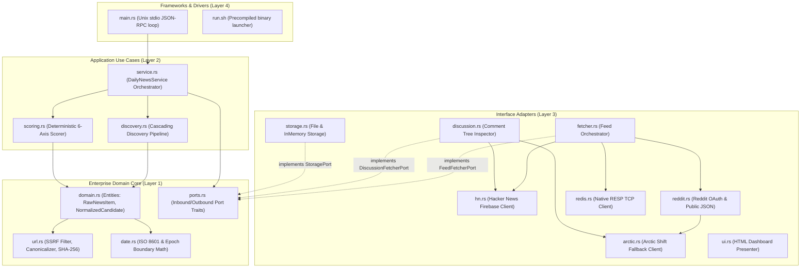
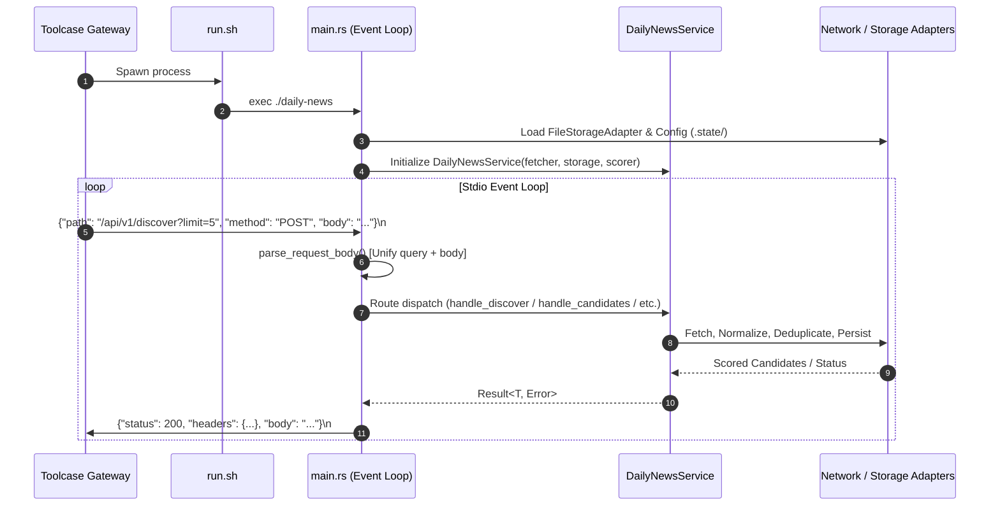
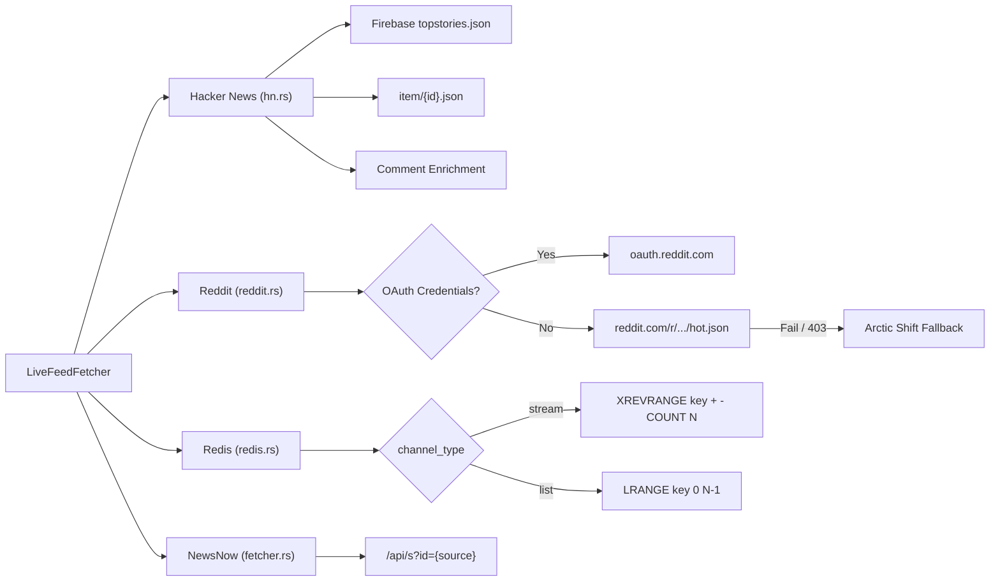
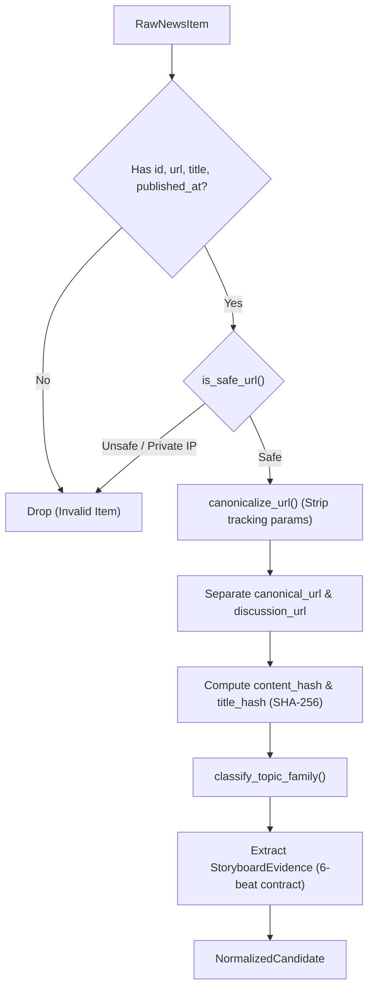
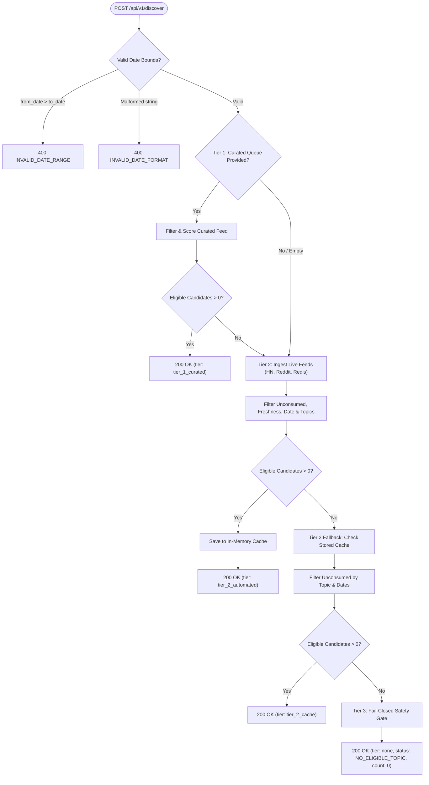
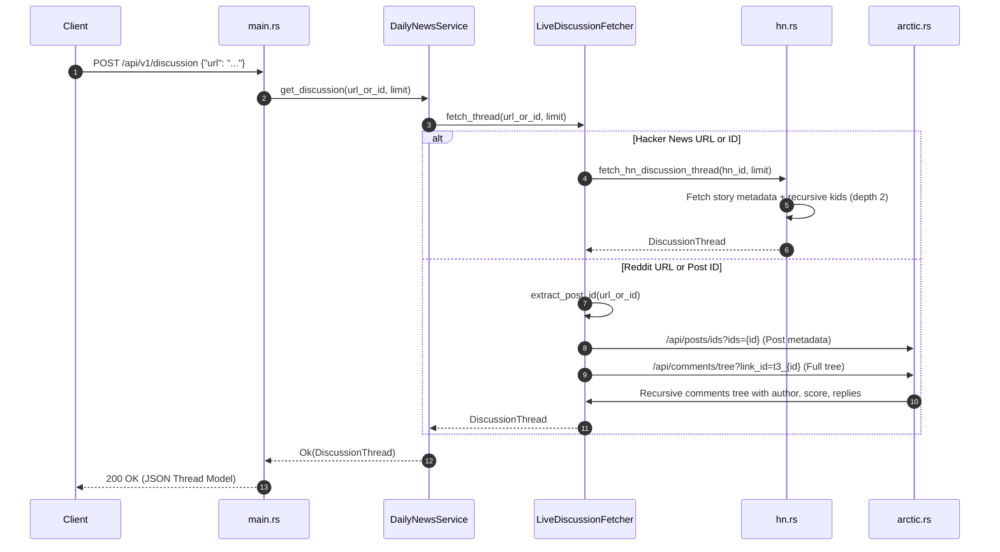
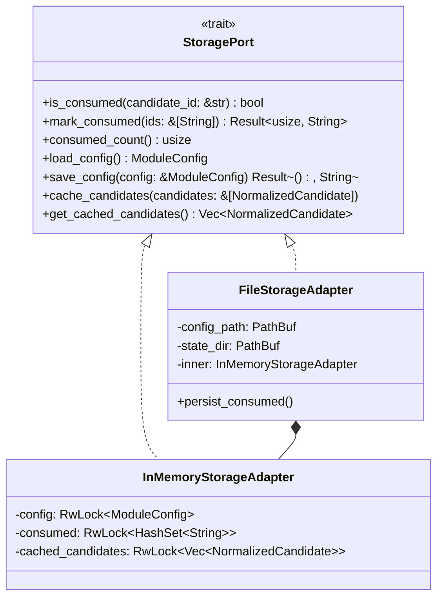

# Daily News & Content Discovery Service (`daily-news`)
## Comprehensive Flow & Architecture Specification

**Module Version**: 1.8.0  
**Implementation**: 100% Native Rust (Zero Python, Zero Async Runtimes)  
**Protocol**: `stdio-stream` JSON-RPC over Standard Input/Output  
**Mount Namespace**: `/custom/daily-news/*`  
**Interactive Visualizer**: Embedded at `/flow` and [`flowchart.html`](./flowchart.html)  

---

## Table of Contents

1. [Executive Summary & Purpose](#1-executive-summary--purpose)
2. [Clean Architecture & Layer Separation](#2-clean-architecture--layer-separation)
3. [Process Lifecycle & Stdio-Stream Framing](#3-process-lifecycle--stdio-stream-framing)
4. [Multi-Source Feed Ingestion Pipeline](#4-multi-source-feed-ingestion-pipeline)
   - [4.1 Hacker News Firebase Pipeline](#41-hacker-news-firebase-pipeline)
   - [4.2 Native Reddit Tiered Ingestion (OAuth, Public, Arctic Shift)](#42-native-reddit-tiered-ingestion-oauth-public-arctic-shift)
   - [4.3 Redis Stream & List Ingestion (Native RESP)](#43-redis-stream--list-ingestion-native-resp)
   - [4.4 Upstream NewsNow Ingestion](#44-upstream-newsnow-ingestion)
5. [Candidate Normalization & Security Boundary](#5-candidate-normalization--security-boundary)
   - [5.1 SSRF Boundary Protection & Private CIDR Filter](#51-ssrf-boundary-protection--private-cidr-filter)
   - [5.2 URL Canonicalization & Tracking Stripping](#52-url-canonicalization--tracking-stripping)
   - [5.3 Dual-Link Resolution Architecture](#53-dual-link-resolution-architecture)
   - [5.4 Cryptographic Hashing & Deduplication](#54-cryptographic-hashing--deduplication)
   - [5.5 6-Beat Storyboard Evidence Contract](#55-6-beat-storyboard-evidence-contract)
6. [Tiered Cascade Discovery Algorithm (`/api/v1/discover`)](#6-tiered-cascade-discovery-algorithm-apiv1discover)
7. [Deterministic 6-Axis Scoring & Ranking Engine](#7-deterministic-6-axis-scoring--ranking-engine)
8. [Discussion Thread & Comment Tree Inspection (`/api/v1/discussion`)](#8-discussion-thread--comment-tree-inspection-apiv1discussion)
9. [State Persistence & Consumption Tracking](#9-state-persistence--consumption-tracking)
10. [Complete Route Catalog & Dispatch Table](#10-complete-route-catalog--dispatch-table)
11. [Verification & Integration Test Suite](#11-verification--integration-test-suite)

---

## 1. Executive Summary & Purpose

The `daily-news` module is a high-throughput, deterministic content ingestion, ranking, and discovery provider designed for **Toolcase Gateway**. Originally extracted from OpenMontage's daily news gathering engine, the service operates entirely out-of-process as a compiled native Rust binary.

### Core Capabilities:
- **Real-Time News Ingestion**: Ingests breaking technical news from Hacker News, Reddit, Redis queues, and NewsNow instances.
- **Fail-Closed Defensive Design**: Strictly filters invalid formats, SSRF targets, and consumed articles; fails closed on missing criteria.
- **Explainable 6-Axis Scoring**: Computes objective scores across Freshness, Publisher Authority, Fact Density, Visual Potential, Audience Interest, and Feasibility.
- **6-Beat Storyboard Engineering Contract**: Provides structured story nodes (`hook`, `symptom`, `root_cause`, `remedy`, etc.) directly usable by downstream automated vertical video pipelines.
- **Zero-Async Concurrency**: Employs non-blocking, synchronous networking with deterministic timeouts to prevent thread starvation or runtime deadlocks.

---

## 2. Clean Architecture & Layer Separation

The codebase strictly enforces the Clean Architecture Dependency Rule: **dependencies only point inwards**. All business logic and domain rules exist independently of transport frameworks, database drivers, and operating system quirks.



### Module Boundary Governance:
- Target file size: **under 450 lines**. Hard ceiling: **800 lines**.
- Domain entities (`domain.rs`), port contracts (`ports.rs`), and date algorithms (`date.rs`) contain zero references to network sockets, HTTP libraries, or disk file handlers.

---

## 3. Process Lifecycle & Stdio-Stream Framing

When Toolcase Gateway starts, it executes `./run.sh`, which loads the precompiled native ELF binary `./daily-news`. Communication flows strictly over standard input (`stdin`) and standard output (`stdout`) using newline-delimited JSON envelopes.



### Request & Response Wire Contract:
1. **Input Envelope**:
   ```json
   {
     "path": "/api/v1/discover?limit=5",
     "method": "POST",
     "headers": { "content-type": "application/json" },
     "body": "{\"topics\": [\"agent_tool_use\"]}"
   }
   ```
2. **Unified Parameter Resolution**: `main.rs::parse_request_body` merges URL query parameters (`?limit=5&from_date=2026-11-01`) and body JSON properties seamlessly. If both exist, the body takes precedence unless empty.
3. **Output Envelope**:
   ```json
   {
     "status": 200,
     "headers": {
       "content-type": "application/json",
       "x-module-engine": "rust-native"
     },
     "body": "{\"tier\":\"tier_2_automated\",\"status\":\"ELIGIBLE\",\"count\":1,\"candidates\":[...]}"
   }
   ```

---

## 4. Multi-Source Feed Ingestion Pipeline

The ingestion layer (`fetcher.rs`) orchestrates real-time feeds across four primary adapters:



### 4.1 Hacker News Firebase Pipeline (`hn.rs`)
1. Fetches IDs from `https://hacker-news.firebaseio.com/v0/topstories.json`.
2. Concurrently pulls detailed metadata from `https://hacker-news.firebaseio.com/v0/item/{id}.json`.
3. **Comment Enrichment**: If the story has no selftext, the adapter fetches the top 2 comments from `kids` and appends them to `description` and `body` (e.g. `alice: Great architecture! | bob: Benchmark reproduced`).
4. Extracts domain publisher and separates discussion URL (`https://news.ycombinator.com/item?id={id}`) from article destination URL.

### 4.2 Native Reddit Tiered Ingestion (`reddit.rs` & `arctic.rs`)
Supports subreddits like `r/LocalLLaMA`, `r/MachineLearning`, `r/artificial`, `r/technology` with a 3-tier fallback strategy:
1. **Tier 1 (Authenticated OAuth)**: If `reddit_client_id` and `reddit_client_secret` are configured, generates an application-only Bearer token via `POST https://www.reddit.com/api/v1/access_token` and queries `https://oauth.reddit.com/r/{sub}/hot`.
2. **Tier 2 (Public JSON)**: If unauthenticated, attempts `https://www.reddit.com/r/{sub}/hot.json` with custom User-Agent headers.
3. **Tier 3 (Zero-Key Arctic Shift Fallback)**: If direct Reddit requests receive HTTP 403 (common in cloud datacenter IP ranges), automatically switches to the Arctic Shift public mirror:
   `https://arctic-shift.photon-reddit.com/api/posts/search?subreddit={sub}&limit={n}`.

### 4.3 Redis Stream & List Ingestion (`redis.rs`)
Implements a synchronous, non-panicking RESP client over `std::net::TcpStream` without third-party Redis dependencies:
- **Redis Streams**: Employs `XREVRANGE <key> + - COUNT <limit>` to read latest entries in reverse chronological order.
- **Redis Lists**: Employs `LRANGE <key> 0 <limit - 1>`.
- Parses JSON payloads or text entries into `RawNewsItem`, extracting timestamps from Redis stream IDs (`<timestamp_ms>-<seq>`).

### 4.4 Upstream NewsNow Ingestion (`fetcher.rs`)
Queries upstream instances of [newsnext/newsnow](https://github.com/newsnext/newsnow) via `GET /api/s?id={source}`.
- **Contract Compatibility**: Directly maps NewsNow's JSON response (`updatedTime`, `items: [{ id, title, url, extra }]`) into `RawNewsItem`.
- **Supported Feed Channels**: Pulls trending feeds from `github`, `producthunt`, `hackernews`, and other platforms registered in the upstream instance.
- **Enrichment & Tracking**: Item IDs are namespaced as `newsnow_{source}_{item_id}`. When the source is `hackernews`, items are automatically cross-referenced with Firebase IDs for author, comment, and discussion tree enrichment.

---

## 5. Candidate Normalization & Security Boundary

Incoming raw feeds undergo rigorous validation and canonicalization in `domain.rs` and `url.rs`:



### 5.1 SSRF Boundary Protection & Private CIDR Filter
All external URLs must pass `is_safe_url`:
- Protocol must strictly be `http://` or `https://`.
- Resolves hostnames and blocks private, link-local, and broadcast IPv4 ranges (CWE-918):
  - `10.0.0.0/8`
  - `172.16.0.0/12`
  - `192.168.0.0/16`
  - `169.254.0.0/16` (Cloud metadata endpoint protection)
  - `0.0.0.0/8`
- Localhost (`127.0.0.1`) is exclusively permitted for local container sidecars (e.g., local NewsNow or Redis).

### 5.2 URL Canonicalization & Tracking Stripping
Removes fragment identifiers (`#...`) and strips marketing/tracking query parameters:
- `utm_source`, `utm_medium`, `utm_campaign`, `utm_term`, `utm_content`
- `fbclid`, `gclid`, `msclkid`, `ref`, `source`, `rss`

### 5.3 Dual-Link Resolution Architecture
- **`canonical_url`**: Direct cleaned link to the primary technical artifact, documentation, or article.
- **`discussion_url`**: Preserves the community comment thread (HN item URL or Reddit permalink) to give LLM agents access to community reactions, benchmark validations, and bug reports.

### 5.4 Cryptographic Hashing & Deduplication
- **`title_hash`**: SHA-256 of lowercase whitespace-normalized title.
- **`content_hash`**: SHA-256 of `clean_title|clean_canonical_url|clean_body_first_500_chars`.
- **`candidate_id`**: Deterministic identifier format `cand_{content_hash[0..16]}`.

### 5.5 6-Beat Storyboard Evidence Contract
The candidate model embeds typed domain fields conforming to the OpenMontage video generation specification:
- `hook`: High-impact opening hook or provocative question.
- `viewer_question`: Technical dilemma addressed by the story.
- `symptom`: Failure mode or limitation observed in real-world deployments.
- `root_cause`: Underlying architectural or computational cause.
- `remedy`: Solution, optimization, or architectural pattern introduced.
- `evidence_excerpt`: Verifiable text excerpt supporting the claims.
- `source_snapshot` & `snapshot_sha256`: Reproducible artifact pointer.

---

## 6. Tiered Cascade Discovery Algorithm (`/api/v1/discover`)

The discovery engine follows a 3-tier cascade to ensure high relevance while failing safely:



### Discovery Tiers:
1. **Tier 1 (`tier_1_curated`)**: Evaluates user-injected candidates (`curated_candidates`). If valid, takes precedence immediately.
2. **Tier 2 (`tier_2_automated`)**: Queries live multi-source feeds, filters out consumed items and stale entries, deduplicates via SHA-256 signatures, ranks them, and caches the results.
3. **Tier 2 Cache (`tier_2_cache`)**: If live ingestion fails or network is disconnected, fallback inspects previously cached candidates matching the date and topic criteria.
4. **Tier 3 (`tier_3_fail_closed`)**: If zero candidates meet freshness, topic, or safety policies, returns `status: NO_ELIGIBLE_TOPIC` with explanatory diagnostic metadata.

---

## 7. Deterministic 6-Axis Scoring & Ranking Engine

Candidates are scored using a weighted multi-factor formula implemented in `scoring.rs`:

$$\text{Score} = (W_F \times F) + (W_A \times A) + (W_D \times D) + (W_V \times V) + (W_I \times I) + (W_{\text{Fe}} \times \text{Fe})$$

| Axis | Weight | Criteria & Implementation |
| :--- | :---: | :--- |
| **Freshness ($F$)** | **30%** | $1.0$ for $<2\text{h}$, decays linearly to $0.5$ at $12\text{h}$, $0.2$ at $24\text{h}$, and $0.1$ for $>24\text{h}$. |
| **Publisher Authority ($A$)** | **20%** | Tier 1 ($1.0$): Reuters, Bloomberg, NYT, Anthropic, OpenAI.<br>Tier 2 ($0.8$): The Verge, TechCrunch, Wired, GitHub, HN, ProductHunt.<br>Known ($0.5$), Unknown ($0.2$). |
| **Fact Density ($D$)** | **20%** | Word count: $>400$ ($1.0$), $>200$ ($0.8$), $>50$ ($0.5$), $\le 50$ ($0.3$).<br>Bonuses: $+0.1$ for quotes, $+0.1$ for numbers/metrics (max $1.0$). |
| **Visual Potential ($V$)** | **15%** | Base: $0.30$. Discussion URL / Image present: $+0.30$.<br>Keywords (`chart`, `graph`, `demo`, `release`, `prototype`, `hardware`): $+0.20$ (1 match) or $+0.40$ ($\ge 2$ matches). |
| **Audience Interest ($I$)** | **10%** | Taxonomy keyword matching ($0.10, 0.75, 1.0$) combined 70/30 with engagement metrics: `(kw_score * 0.7) + (min(1.0, (upvotes + 2*comments) / 100.0) * 0.3)`. |
| **Feasibility ($\text{Fe}$)** | **5%** | Baseline $1.0$ indicating reproducible, valid candidate schema. |

### Deterministic Tie-Breaking:
If two candidates have identical total scores, they are sorted alphabetically by `candidate_id` to guarantee identical ordering across runs.

---

## 8. Discussion Thread & Comment Tree Inspection (`/api/v1/discussion`)

The `/api/v1/discussion` endpoint provides full contextual thread inspection for LLM research agents:



### Response Thread Structure:
```json
{
  "id": "1xmitzx",
  "subreddit": "LocalLLaMA",
  "title": "Alibaba Releases Qwen 2.5 Coder",
  "author": "open_researcher",
  "permalink": "https://www.reddit.com/r/LocalLLaMA/comments/1xmitzx/...",
  "url": "https://github.com/QwenLM/Qwen2.5-Coder",
  "selftext": "Benchmark results and evaluation notes across code benchmarks.",
  "score": 384,
  "num_comments": 92,
  "comments": [
    {
      "id": "c1abcde",
      "author": "quant_dev",
      "body": "FP8 weights run smoothly on RTX 4090.",
      "score": 45,
      "created_utc": 1730548000,
      "created_at": "2026-11-02T11:46:40+00:00",
      "permalink": "https://www.reddit.com/r/LocalLLaMA/comments/.../c1abcde/",
      "replies": []
    }
  ]
}
```

---

## 9. State Persistence & Consumption Tracking

Persistence is implemented using the **Decorator Pattern** in `storage.rs`:



### Persistence Invariants:
1. **Thread-Safe Mutexing**: All in-memory structures are guarded by `std::sync::RwLock` for high concurrent read throughput.
2. **Atomic Disk Flushing**: Consumed candidate IDs are persisted to `.state/consumed.json`.
3. **Zero State Pollution in Tests**: Unit tests utilize `InMemoryStorageAdapter`, completely isolating disk state during testing.

---

## 10. Complete Route Catalog & Dispatch Table

| Method | Subpath | Gateway URI | Handler | Description |
| :---: | :--- | :--- | :--- | :--- |
| `GET` | `/health` | `/custom/daily-news/health` | `handle_health` | Health, engine runtime, version, and consumed counts. |
| `GET` | `/models` | `/custom/daily-news/models` | `handle_models` | OpenAI-compatible model registry (`daily-news`). |
| `GET` | `/ui` or `/` | `/custom/daily-news/ui` | `handle_ui` | Responsive, dark-mode administrative dashboard. |
| `POST` | `/chat/completions` | `/custom/daily-news/chat/completions` | `handle_chat_completions` | Markdown-formatted news briefing completion. |
| `POST` | `/api/v1/discover` | `/custom/daily-news/api/v1/discover` | `handle_discover` | Cascading 3-tier content discovery pipeline. |
| `GET` | `/api/v1/candidates` | `/custom/daily-news/api/v1/candidates` | `handle_candidates` | Returns currently scored candidates. |
| `POST` | `/api/v1/candidates` | `/custom/daily-news/api/v1/candidates` | `handle_candidates` | Normalizes and scores user-injected raw items. |
| `GET`/`POST` | `/api/v1/feed` | `/custom/daily-news/api/v1/feed` | `handle_feed` | Raw ingested items before scoring. |
| `GET`/`POST` | `/api/v1/discussion` | `/custom/daily-news/api/v1/discussion` | `handle_discussion` | Structured comment trees & thread metadata. |
| `POST` | `/api/v1/consume` | `/custom/daily-news/api/v1/consume` | `handle_consume` | Marks candidate IDs as consumed. |
| `GET` | `/api/v1/config` | `/custom/daily-news/api/v1/config` | `handle_config` | Returns active runtime configuration. |
| `POST` | `/api/v1/config` | `/custom/daily-news/api/v1/config` | `handle_config` | Dynamic configuration update. |

---

## 11. Verification & Integration Test Suite

The module is verified by an exhaustive 51-test automated suite covering all failure modes, sanitizers, and network resilience:

| Test Suite | File | Tests | Coverage Scope |
| :--- | :--- | :---: | :--- |
| **Unit Library** | [`src/lib.rs`](file:///home/ubuntu/gateway-modules/modules/daily-news/src/lib.rs) | 26 | Freshness curves, publisher authority, date math, URL canonicalization, Redis RESP parsing, Reddit JSON parsing, Arctic Shift fallback, dashboard HTML rendering. |
| **Adapter Framing** | [`tests/test_adapter.rs`](file:///home/ubuntu/gateway-modules/modules/daily-news/tests/test_adapter.rs) | 10 | Unix stdio JSON-RPC loop, query parameter aliases, `/health`, `/models`, `/ui`, `/chat/completions`, `/api/v1/discussion`. |
| **Cascade Discovery** | [`tests/test_discovery.rs`](file:///home/ubuntu/gateway-modules/modules/daily-news/tests/test_discovery.rs) | 3 | Tier-1 priority, date boundaries, topic matching, and fail-closed safety gate. |
| **Domain Logic** | [`tests/test_domain.rs`](file:///home/ubuntu/gateway-modules/modules/daily-news/tests/test_domain.rs) | 5 | SSRF IP range filtering, publisher normalization, SHA-256 hashes, ISO 8601 parsing. |
| **Normalizer** | [`tests/test_normalizer.rs`](file:///home/ubuntu/gateway-modules/modules/daily-news/tests/test_normalizer.rs) | 4 | Batch deduplication, missing fields validation, 6-beat storyboard mapping. |
| **Reddit Ingestion** | [`tests/test_reddit.rs`](file:///home/ubuntu/gateway-modules/modules/daily-news/tests/test_reddit.rs) | 5 | Provider initialization, Arctic Shift parsing, offline resilience. |
| **Redis RESP** | [`tests/test_redis.rs`](file:///home/ubuntu/gateway-modules/modules/daily-news/tests/test_redis.rs) | 4 | RESP socket parser, list & stream commands, offline fallback. |

To execute the test suite:
```bash
CARGO_TARGET_DIR=/tmp/cargo-target cargo test --manifest-path modules/daily-news/Cargo.toml
```
Result: **51 passed; 0 failed; 0 warnings**.
