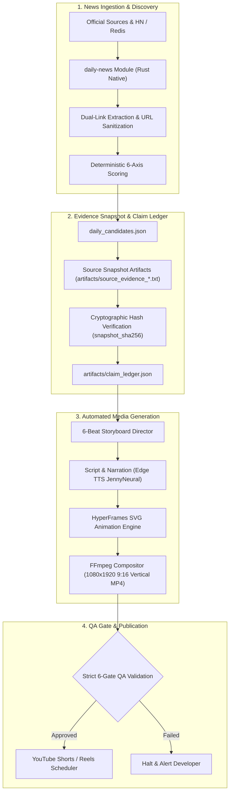

# OpenMontage Video Generation Pipeline Integration Guide

This guide details how the native Rust `daily-news` module integrates with the OpenMontage generative media pipeline (`NEWS_CONTENT_INGESTION_AND_VIDEO_GENERATION_FLOW.md`) to ingest news, produce cryptographic evidence snapshots, and drive automated vertical video generation (YouTube Shorts, Facebook Reels, TikTok).

---

## 1. End-to-End Pipeline Overview



---

## 2. The 6-Beat Storyboard Engineering Contract

Vertical AI engineering breakdowns follow a strict **6-beat storytelling structure**. The `daily-news` candidate contract provides first-class, typed domain fields (`StoryboardEvidence`) that feed directly into the OpenMontage Storyboard Director:

| Storyboard Beat | Duration | Candidate Field | Purpose & Content |
| :--- | :--- | :--- | :--- |
| **Beat 1: The Hook** | 0s – 5s | `hook` | Pattern interrupt grabbing developer attention: *"Is your coding agent choking on 50 MCP tool definitions?"* |
| **Beat 2: Symptom** | 5s – 15s | `symptom` | Specific, relatable developer pain: *"Context window exhausted before reasoning starts; agent loops and crashes."* |
| **Beat 3: Root Cause** | 15s – 25s | `root_cause` | Architectural diagnosis: *"Eager tool registration dumps every available tool schema into the system prompt at startup."* |
| **Beat 4: Technical Remedy** | 25s – 45s | `remedy` | Concrete code/architecture solution: *"Implement two-tier tool resolution: expose lookup meta-tool and lazy-load schemas on demand."* |
| **Beat 5: Evidence Excerpt** | 45s – 55s | `evidence_excerpt` | Primary factual quote or benchmark proof from the official doc, paper, or release notes. |
| **Beat 6: Viewer Question / CTA**| 55s – 65s | `viewer_question` | Engaging closing prompt prompting community discussion in comments. |

### Field Structure in Candidates
Because `daily-news` utilizes `#[serde(flatten)] pub evidence: StoryboardEvidence`, all 6-beat fields serialize at the root of each candidate object in `daily_candidates.json`:

```json
{
  "candidate_id": "cand_mcp_tool_scoping",
  "title": "Dynamic MCP Tool Scoping: Slashing Context Bloat",
  "canonical_url": "https://modelcontextprotocol.io/specification/server/tools",
  "discussion_url": "https://news.ycombinator.com/item?id=50334704",
  "topic_family": "agent_tool_use",
  "hook": "Is your coding agent choking on 50 MCP tool definitions?",
  "symptom": "Coding agent context window overwhelmed by thousands of lines of unused tool schemas.",
  "root_cause": "Eager tool registration dumps every tool definition into system prompt.",
  "remedy": "Implement two-tier tool resolution: expose search/lookup meta-tool and lazy-load schemas.",
  "evidence_excerpt": "Tool schemas may now be dynamically requested via lookup protocol.",
  "source_snapshot": "artifacts/source_evidence_s1.txt",
  "snapshot_sha256": "2bad0815c06b65dbe5d27759f1e92852a96473001e0daf2f98f32ced70444d72"
}
```

---

## 3. Cryptographic Evidence Snapshots & SHA-256 Ledgers

To ensure video scripts never hallucinate claims or rely on ephemeral web pages:
1. **Source Capture**: When a candidate is approved for production, its primary source page is captured into a raw text artifact: `artifacts/source_evidence_<cand_id>.txt`.
2. **SHA-256 Digest**: The file's cryptographic hash is stored in `snapshot_sha256`.
3. **Ledger Alignment**: During script compilation, OpenMontage verifies that:
   $$\text{SHA256}(\text{artifacts/source\_evidence\_*.txt}) == \text{snapshot\_sha256}$$
   If the hash mismatches or the snapshot is missing, the QA gate immediately fails closed with code `EVIDENCE_SNAPSHOT_TAMPERED`.

---

## 4. Dual-Link Architecture for High-Engagement Video Descriptions

Every video description generated by the pipeline requires two distinct links:
1. **The Primary Source (`canonical_url`)**:
   - Cleaned, tracking-free URL pointing directly to the documentation, ArXiv paper, or release notes.
   - Used for the pinned comment: *"Official Documentation: https://modelcontextprotocol.io/..."*
2. **The Community Thread (`discussion_url`)**:
   - The Hacker News, Reddit, or forum discussion URL where developers are actively debating the release.
   - Used for community proof: *"Join the HN discussion: https://news.ycombinator.com/item?id=..."*

---

## 5. Topic Family Classification Taxonomy

Candidates must strictly belong to one of the **5 Practical AI Agent Engineering** topic families:

| Topic Family (`topic_family`) | Typical Keywords & Triggers | Story Angle |
| :--- | :--- | :--- |
| `context_memory` | `prompt caching`, `context window`, `kv cache`, `memory`, `state loss`, `token limit` | Preserving agent memory across long multi-turn sessions without context overflow. |
| `agent_tool_use` | `mcp`, `tool call`, `schema`, `function call`, `payload parsing`, `dynamic tools` | Designing bulletproof schemas and eliminating tool execution hallucination. |
| `debugging_reliability` | `debug`, `retry`, `flaky`, `reliability`, `ci`, `loop`, `crash`, `trace` | Trapping agent death loops, flaky test retries, and silent runtime breaks. |
| `agent_evaluation` | `benchmark`, `eval`, `evaluation`, `score`, `metrics`, `test suite` | Replacing fragile single-run vibe checks with deterministic benchmark matrices. |
| `agent_architecture` | `multi-agent`, `handoff`, `immutable state`, `protocol`, `daemon` | Coordinating autonomous subagents with immutable message passing. |

---

## 6. Automating Discovery from OpenMontage

In automated production runs, OpenMontage invokes `daily-news` via HTTP through Toolcase Gateway:

```python
import requests

def fetch_daily_candidates(topic="agent_tool_use", limit=3):
    url = "http://127.0.0.1:28130/custom/daily-news/api/v1/discover"
    params = {
        "topics": topic,
        "limit": limit,
        "from_date": "2026-11-01",
        "to_date": "2026-11-02"
    }
    resp = requests.post(url, params=params, timeout=15)
    resp.raise_for_status()
    data = resp.json()
    
    if data.get("status") != "ELIGIBLE":
        raise ValueError(f"Discovery failed closed: {data.get('reason')}")
        
    return data.get("candidates", [])
```

After rendering and successful publication to YouTube Shorts / Reels, OpenMontage consumes the candidate IDs:

```python
def mark_published_candidates(candidate_ids):
    url = "http://127.0.0.1:28130/custom/daily-news/api/v1/consume"
    requests.post(url, json={"candidate_ids": candidate_ids}, timeout=10)
```
